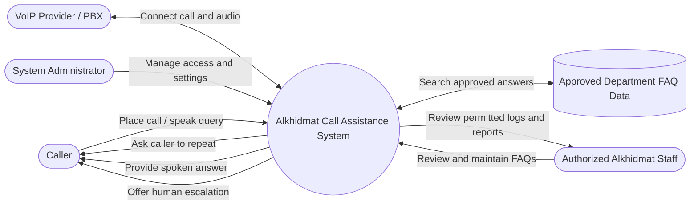

# Software Requirements Specification
## AI-Powered Voice and Messaging Gateway for Al-Khidmat Foundation
### First Portion: Introduction and Core Requirements

**Version:** 0.1 working draft  
**Status:** For team and supervisor review

## 1. Introduction

### 1.1 Purpose

This document defines the purpose, scope, functional requirements, and non-functional requirements for the first portion of the SRS for the AI-powered voice and messaging gateway proposed for Al-Khidmat Foundation. The system is intended to provide one bilingual first-response gateway over phone and WhatsApp, answer supported routine questions, and route unresolved, complex, or sensitive cases to the appropriate division and staff. This document is for the FYP team, supervisor, and Al-Khidmat stakeholders to review and validate.

### 1.2 Project context and current status

The project addresses the difficulty beneficiaries may have identifying the correct Al-Khidmat department, obtaining service information, and receiving timely responses. The proposal specifies a unified phone and WhatsApp gateway, bilingual Urdu/English interactions, routine FAQ responses, request classification and routing, human escalation, a central session manager, a staff dashboard, and analytics. The detailed AI, knowledge-base, conversation-flow, and evaluation work is initially focused on Healthcare Services and Funeral Services; the architecture is intended to support all eight divisions.

A local voice prototype has been assembled using Linphone, Asterisk, a Python EAGI handler, and faster-whisper. Linphone makes a test call to Asterisk; the handler receives audio chunks and Whisper currently produces English text using its translation task. This demonstrates an early voice-audio path only; it does not implement the full proposed gateway.

The repository currently contains FAQ data in CSV and JSONL formats for eight areas: Bano Qabil, Community Services, Disaster Management, Education, Health Services, Islamic Microfinance, Orphan Care, and WASH. The proposal's initial knowledge-base focus is Healthcare Services and Funeral Services. The supplied FAQ directory includes Health Services but no clearly named Funeral Services dataset, so the Funeral Services content and the mapping of these FAQ categories to Al-Khidmat's official divisions need confirmation. Al-Khidmat is also expected to provide WhatsApp messages, voice recordings, and examples of queries commonly received by phone. Their delivery, permissions, formats, quality, and approved uses must be confirmed before they are treated as available training or production data.

Alkhidmat is discussing VoIP access with Telenor and hosting with Alibaba. Neither provider integration nor Alibaba deployment is confirmed in this draft. The production design depends on the interfaces, security requirements, and service terms Alkhidmat ultimately receives.

### 1.3 Scope

The proposed system will:

- Accept incoming voice enquiries through an Alkhidmat-approved telephony connection.
- Accept WhatsApp enquiries through the WhatsApp Business API and its approved webhook integration.
- Convert caller speech into text and support Urdu, English, and mixed Urdu-English input, subject to validation against supplied data.
- Identify the relevant department or service area.
- Use a central session manager to coordinate intent classification, FAQ answering, division routing, and escalation.
- Retrieve answers from approved FAQ and department information, initially focusing on Healthcare Services and Funeral Services.
- Communicate an answer to the caller using generated speech, where enabled.
- Escalate an enquiry when no sufficiently supported answer is available.
- Provide a unified staff dashboard to monitor and handle routed queries, plus analytics for query types, workload, response times, automation, and escalation patterns.
- Support authorized staff in maintaining FAQ content and reviewing system performance.

The current local prototype is limited to Linphone-to-Asterisk calling and Whisper-based English text output. WhatsApp integration, Intent Classifier, FAQ/Routing/Escalation Agents, central session management, verified knowledge-base integration for the priority divisions, caller-facing spoken answers, staff dashboard, analytics, provider integration, and cloud deployment remain future work. The system will not make emergency dispatch decisions, approve applications, determine eligibility, or invent answers not supported by approved information.

### 1.4 Definitions

| Term | Meaning |
|---|---|
| VoIP | Voice calling carried over an IP network. |
| SIP | A signaling protocol commonly used to establish and manage VoIP calls. |
| PBX | A phone system that answers and routes calls; Asterisk is used as the local prototype PBX. |
| STT / ASR | Speech-to-text / automatic speech recognition. |
| TTS | Text-to-speech: generating spoken audio from text. |
| FAQ corpus | Department questions and approved answers used by the system. |

### 1.5 Assumptions and dependencies

- Alkhidmat will identify an authorized source and owner for department information and FAQs.
- Alkhidmat will confirm whether WhatsApp messages, voice recordings, and call-query examples may be used, and under what consent, privacy, and retention rules.
- The provider must document the call interface available to the project (for example, SIP trunk, PBX extension, forwarding, or another supported interface) before production telephony requirements are finalized.
- Alibaba hosting is under discussion only. Hosting region, architecture, budget, security controls, and operational ownership remain to be agreed.
- The team has not committed to training or fine-tuning a speech model. The current prototype uses a pre-trained Whisper model; further model adaptation depends on data rights, data quality, evaluation results, and supervisor approval.

## 2. Functional Requirements

Requirements below are numbered for review. “Shall” statements are proposed requirements and should be validated with Alkhidmat and the supervisor.

### 2.1 Call handling

**FR-01** The system shall accept an incoming call through the telephony interface approved for the production deployment.  
**FR-01a** The system shall accept WhatsApp messages through the WhatsApp Business API integration approved for deployment.  
**FR-02** The system shall provide an initial greeting and indicate when the caller may speak.  
**FR-03** The system shall capture caller audio for processing while the call is active.  
**FR-04** The system shall detect pauses and divide caller audio into speech segments for processing.  
**FR-05** The system shall allow a caller to end the call at any time.  
**FR-06** The system shall associate each call's processing events and generated responses with a unique call identifier.

### 2.2 Speech recognition and language handling

**FR-07** The system shall convert caller speech into text for downstream processing.  
**FR-08** The system shall support Urdu and English speech and shall be evaluated on mixed Urdu-English speech using approved test examples.  
**FR-09** The system shall provide an English translation of caller speech when English output is required by the response workflow.  
**FR-10** The system shall preserve the original audio for the duration and purpose approved by Alkhidmat; storage shall be disabled or limited when policy requires.  
**FR-11** The system shall detect or record low-confidence speech processing and shall request repetition or route the call for human assistance rather than silently treating uncertain text as certain.

### 2.3 Department identification and FAQ answering

**FR-12** The system shall identify a likely department or service area from the caller's query.  
**FR-12a** The system shall classify each incoming voice or WhatsApp request by intent using an Intent Classifier component.  
**FR-12b** A central session manager shall maintain the interaction context and coordinate the FAQ, routing, and escalation functions across supported channels.  
**FR-13** The system shall search only approved FAQ content for an answer.  
**FR-14** The system shall associate each FAQ entry with its department, approved answer, source or owner, and last-reviewed date.  
**FR-15** The system shall provide an answer only when a relevant approved FAQ or knowledge source supports it.  
**FR-16** If no supported answer is found, the system shall state that it cannot confirm the answer and offer a human handoff or approved contact route.  
**FR-16a** The Routing Agent shall route unresolved requests to the appropriate division using approved routing rules.  
**FR-16b** The Escalation Agent shall transfer complex, sensitive, ambiguous, or unsupported requests to human staff.  
**FR-17** The system shall support the following initial FAQ areas: Bano Qabil, Community Services, Disaster Management, Education, Health Services, Islamic Microfinance, Orphan Care, and WASH.  
**FR-18** The system shall allow authorized staff to add, update, deactivate, and review FAQ entries.  
**FR-19** The system shall retain a record of FAQ changes, including editor, timestamp, and changed fields.

### 2.4 Response and escalation

**FR-20** The system shall generate a spoken response from approved answer text when TTS is enabled.  
**FR-21** The system shall return generated audio to the caller through the active telephony session.  
**FR-22** The system shall offer or initiate human escalation when requested by the caller, when confidence is low, or when the query is outside approved scope.  
**FR-23** The system shall not present generated or retrieved information as an official policy unless the information is present in an approved source.

### 2.5 Data and administration

**FR-24** The system shall support approved FAQ files and structured FAQ records as input.  
**FR-25** The system shall support importing approved WhatsApp text and call-query examples for FAQ improvement or evaluation, subject to Alkhidmat's data-use approval.  
**FR-26** The system shall support processing approved voice recordings for evaluation and, only if separately approved, model adaptation.  
**FR-27** The system shall log call identifier, timestamps, language-detection result, processing outcome, selected FAQ reference, and escalation outcome, subject to the agreed data-retention policy.  
**FR-28** The system shall provide authorized administrators with a way to review errors and report aggregate usage and quality measures without exposing unnecessary caller information.
**FR-29** The system shall provide a unified staff dashboard for monitoring routed queries and recording staff handling outcomes.  
**FR-30** The analytics module shall report query types, workload, response times, routine-query automation, and escalation patterns.

### 2.6 Use case diagram

**Primary use case: Ask a department question**  
**Actor:** Caller. **Precondition:** The call has connected. **Main flow:** (1) System greets caller. (2) Caller states a question. (3) System captures and transcribes or translates speech. (4) System selects a likely department and searches approved FAQs. (5) System speaks a supported answer. (6) Caller may ask another question or end the call. **Alternate flow:** If speech is unclear, system asks the caller to repeat. If no supported answer is found or the caller asks for a person, system offers the approved human escalation route. **Postcondition:** The call outcome is logged according to the retention policy.

## 3. Non-Functional Requirements

The proposal sets an average AI response-time target of under 30 seconds and an approximate routine-query automation target of 60-70%. These are project targets, not measured results, and should be validated through agreed tests. Additional targets below are proposed for stakeholder review.

### 3.1 Performance

**NFR-PERF-01** The average AI response time for supported test queries shall be under 30 seconds, matching the proposal target; the measurement start and end points shall be fixed in the evaluation plan.  
**NFR-PERF-02** The system should resolve approximately 60-70% of routine test queries without human intervention, matching the proposal target; this is a target to evaluate, not a guaranteed outcome.  
**NFR-PERF-03** Concurrent-call capacity shall be set after the VoIP provider confirms available channels and hosting capacity.  
**NFR-PERF-04** The system shall record processing timestamps so speech-to-text, FAQ retrieval, and TTS latency can be measured separately.

### 3.2 Security and privacy

**NFR-SEC-01** All administrative access shall require authenticated accounts, and permissions shall be limited by role.  
**NFR-SEC-02** Call audio, transcripts, WhatsApp data, and FAQs shall be protected in transit and at rest using controls supported by the selected hosting and telephony environment.  
**NFR-SEC-03** Access to call records and source datasets shall be logged and limited to authorized project or Alkhidmat personnel.  
**NFR-SEC-04** The system shall collect and retain only data approved for the stated purpose; retention periods and caller notice/consent requirements must be confirmed with Alkhidmat.  
**NFR-SEC-05** Production credentials and provider secrets shall be stored outside source code and restricted to authorized operators.

### 3.3 Reliability and availability

**NFR-REL-01** The production service should target 99.5% monthly availability, excluding planned maintenance, subject to provider and hosting service levels.  
**NFR-REL-02** If STT, FAQ retrieval, or TTS fails, the system shall fail safely by informing the caller and offering an approved fallback or human escalation.  
**NFR-REL-03** The system shall record component failures with timestamps and call identifiers while avoiding unnecessary sensitive content in error logs.

### 3.4 Usability and accessibility

**NFR-USE-01** The caller flow shall use short, plain spoken prompts and shall not require the caller to use a smartphone application.  
**NFR-USE-02** The system should support Urdu and English caller interactions; language and accent coverage shall be assessed with representative approved samples.  
**NFR-USE-03** The system shall allow callers to repeat a query and shall provide a clear route to human assistance.

### 3.5 Scalability and deployment

**NFR-SCALE-01** The application should support adding departments and FAQ entries without redesigning the call flow.  
**NFR-SCALE-02** The system should allow speech processing capacity to be increased independently of telephony capacity.  
**NFR-DEPLOY-01** The prototype currently runs locally. Production may use Alibaba Cloud if Alkhidmat approves the account, region, network design, budget, and security controls; hosting provider remains TBD.  
**NFR-DEPLOY-02** The system shall use the call interface confirmed by the VoIP provider; SIP trunk details, codecs, network ports, concurrent channels, and failover behavior are TBD pending provider documentation.

### 3.6 Data integrity

**NFR-DATA-01** Each FAQ answer shall retain a department, source/owner, version or update timestamp, and approval status.  
**NFR-DATA-02** Only authorized staff shall modify approved FAQ records; changes shall be auditable and reversible.  
**NFR-DATA-03** Imports from WhatsApp, voice recordings, or call-query data shall retain source and import date and shall not overwrite approved FAQ answers without review.  
**NFR-DATA-04** The system shall validate required fields and encoding when importing CSV, JSONL, or other approved formats and report rejected records.

### 3.7 Backup and recovery

**NFR-BACKUP-01** The production FAQ database and configuration should be backed up at least daily, with a proposed recovery point objective of 24 hours.  
**NFR-BACKUP-02** Backups containing caller data shall be encrypted and access-controlled under the same retention rules as the source data.  
**NFR-BACKUP-03** The team or operator shall perform a restore test at least once per term and record the result.  
**NFR-BACKUP-04** Recovery time objective is proposed as 8 hours and must be confirmed with Alkhidmat based on service expectations.

### 3.8 Compliance and data governance

**NFR-COMP-01** Before production use, Alkhidmat shall approve data sources, consent/notice, purpose limitation, access, retention, deletion, and any cross-border cloud processing.  
**NFR-COMP-02** WhatsApp messages and call recordings shall not be used for model training or fine-tuning unless Alkhidmat explicitly authorizes that use and confirms applicable permissions.  
**NFR-COMP-03** The system shall distinguish model-generated output from verified source content in internal review and quality evaluation.

## 4. Items Requiring Stakeholder Confirmation

1. Does Telenor or another provider provide a SIP trunk, a SIP extension, call forwarding, or a different interface? Obtain the technical integration guide.
2. Is Alibaba Cloud selected, and which region, network, identity, backup, and security services are approved?
3. Which languages and caller accents must be supported at initial launch? Is English translation required for every call or only internal records?
4. Which WhatsApp messages, recordings, and phone-query datasets may be used, and what are their consent and retention conditions?
5. May recordings be used only for evaluation, or also for model fine-tuning? Who approves datasets and transcripts?
6. Who owns and approves each department FAQ, and how often must answers be reviewed?
7. What are acceptable latency, call capacity, availability, retention, recovery, and human-escalation targets?

